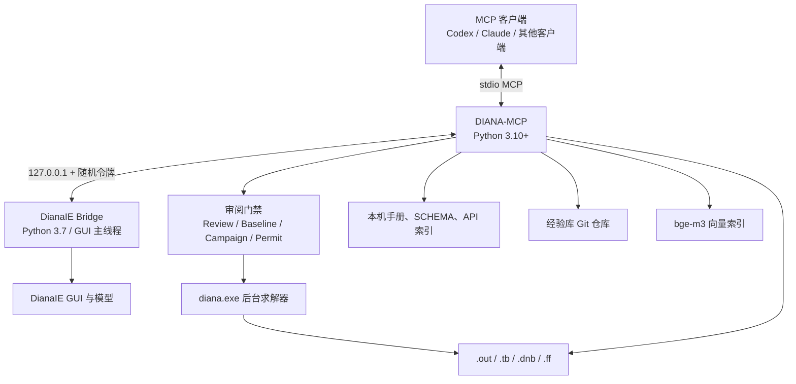
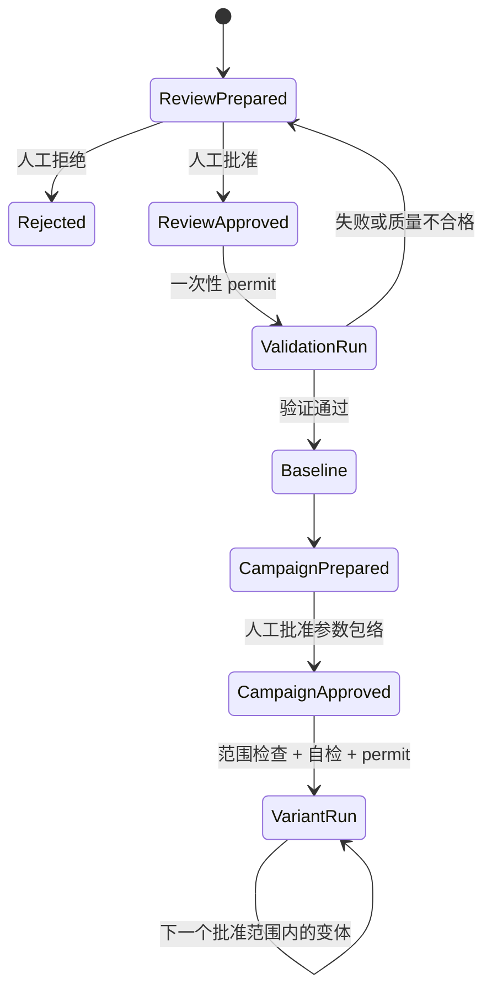

# 架构说明

## 总览

主服务器运行在普通 Python 中，DianaIE 桥接运行在 DIANA 内嵌的 Python 3.7 中。两者通过本机 TCP JSON-lines 协议连接；会话文件包含进程号、回环端口和随机令牌。

## 为什么使用 GUI 主线程桥接

DianaIE 的 API 与 GUI 状态绑定，且空闲时可能长期持有 Python GIL。普通后台 Python 线程无法可靠轮询。桥接因此使用 Win32 定时器在 GUI 主线程中短暂处理请求，保持 API 调用与 DianaIE 线程模型一致。

`diana_execute` 的代码在该线程中执行，因此：

- 必须兼容 Python 3.7；
- 不能调用 `pause()` 或打开阻塞式对话框；
- 长任务应设合理超时；
- 修改后应读取返回值并用结构化快照核对。

## 两条模型观测链

### 命令日志与 Journal

DianaIE 的命令历史记录 API 调用。桥接在处理 MCP 请求前后标记日志字节范围为 `user` 或 `ai`，并记录撤销/重做计数。`diana_changes` 据此解释增量操作。

优点是能回答“谁做了什么”；限制是并非所有只读或内部 API 都会写日志。

### 结构化 Snapshot

快照读取模型报告树、对象参数、指派、网格、分析命令和单位。`diana_model_diff` 比较最终状态，能发现没有清晰命令日志的变化。

优点是能回答“现在与之前有什么不同”；限制是视图状态等非模型信息不会全部纳入。

两条链互相补充，不应把命令日志当作模型真相，也不应把快照差异当作完整操作审计。

## 求解审阅门禁

门禁采用四类持久对象：

1. **Review**：某次完整 GUI 展示及人的决定；
2. **Baseline**：经人审阅、验证求解和质量检查的不可变输入；
3. **Campaign**：围绕某个基准批准的参数范围、自检和质量规则；
4. **Permit**：绑定确切输入哈希、只能消费一次的最终启动许可。

任何状态文件缺失、损坏、模型指纹变化、哈希不一致、参数越界或许可重复使用都会关闭求解通道，而不是降级放行。

## 后台作业与结果

作业管理器把 DianaIE 导出的分析输入复制到独立目录，补齐独立求解所需的 `*FILOS`、`*INPUT` 和 `*END`，并只在副本中调整 TABULA 布局。`diana.exe` 作为子进程运行；返回码与 `.out` 的实际结束状态共同决定成功或失败。

结果层分为：

- `.out`：步骤、收敛、错误、警告、特征值和时间；
- `.tb`：可筛选的文本结果，默认关闭分页；
- `.dnb`：由 DianaIE 加载、绘图和高精度表格查询；
- `.ff`：FILOS 数据库，仅在重启动等场景按需保留。

## 本地知识系统

知识检索把多个独立来源融合排序：

- DIANA 用户手册页面；
- `lib\SCHEMA` 关键字；
- DianaIE API 索引；
- 中英文术语表；
- 用户经验条目；
- 可选语义向量检索。

经验库使用 Markdown + YAML front matter，并拥有独立 Git 历史。自动学习只生成 `draft`；可执行验证只记录检查结果；`verified` 必须由人明确批准。

## Profile 拆分

远程环境可把计算面和知识面分开：

- `compute` 靠近 DianaIE、许可证和模型文件；
- `knowledge` 靠近用户、经验库和 GPU 向量模型；
- MCP 客户端同时连接两台 stdio 服务器。

这种拆分避免把工程模型复制到知识电脑。远程历史日志挖掘通过 SSH 流式读取临时文件，解析后立即删除，但经验条目仍可能包含错误消息和路径，必须人工脱敏。

## 兼容边界

- 主服务器：Python 3.10+；
- GUI 桥接：DIANA 10.5 内嵌 Python 3.7；
- 当前实机验证目标：DIANA 10.5；
- 传输：本机回环 TCP 或由外部 SSH 承载的 MCP stdio；
- MCP SDK：`mcp>=2.2,<3`。

升级 DIANA 或 MCP SDK 时，应先运行非真机测试，再在隔离工程上运行 live 测试，不应直接拿生产工程做兼容性试验。
