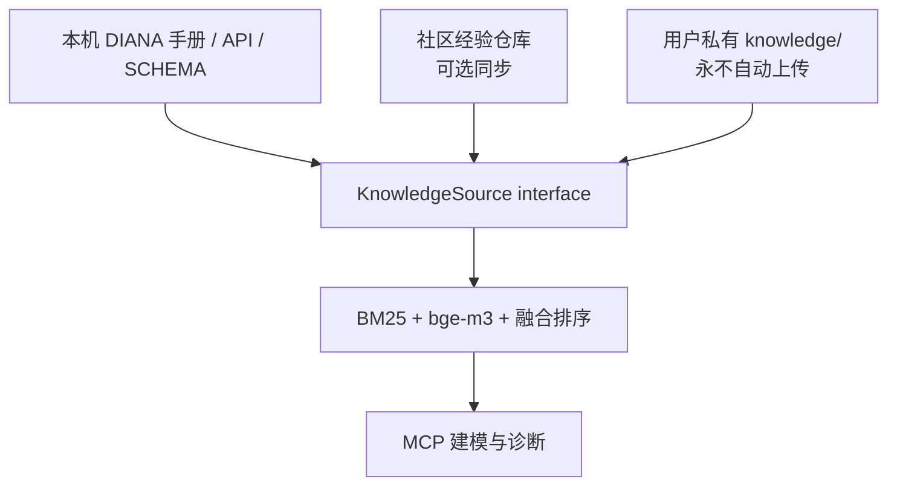

# 社区知识网络

> 状态：架构提案，尚未在当前 v0.9.0 中启用。现有本地经验库和检索功能不依赖社区网络。

## 目标

社区知识网络让不同用户贡献可复用的 DIANA 建模经验，同时保留三个原则：

1. 用户工程、日志和私有经验默认只留在本机；
2. 未验证经验必须明确标注，不能冒充 DIANA 官方结论；
3. 社区仓库可以自动维护，但自动化不能通过降低安全和证据标准实现。

## 三层架构



`KnowledgeSource` 是知识来源 seam。现有本地经验和未来社区 Git 仓库分别通过 Adapter 接入；建模和检索模块只理解统一文档、来源、状态、适用版本和可信度，不需要理解 GitHub、同步或脱敏实现。

建议把社区内容放在独立仓库 `ZhangShirui2002/Diana-MCP-Knowledge`，主仓库只保存同步、验证和检索代码。独立仓库便于高频更新知识，而不要求为每次经验修订发布新的 MCP 版本。

## 自动维护模型

自动维护不等于自动认定正确。社区仓库按以下生命周期运行：

```text
贡献草稿
  ↓
格式 / 许可证 / 脱敏 / 提示注入 / 重复检查
  ↓
自动合并为 candidate（未验证）
  ↓
独立用户复现、结构化反馈、声明式验证
  ↓
调整 confidence 和适用版本
  ├─ 证据充分 → community-confirmed
  ├─ 可重复机器验证 → reproducibly-verified
  ├─ 结论冲突 → disputed
  └─ 新版本不再适用 → obsolete
```

GitHub Actions 或维护机器人可以自动完成：

- YAML/schema 校验；
- 敏感路径、IP、邮箱、凭据和项目名称扫描；
- 与已有条目的语义重复和矛盾检测；
- DIANA 版本、单位制和结果容差完整性检查；
- 根据复现反馈计算可信度；
- 自动建立争议条目、过时标记和版本分支；
- 定期生成带校验值的知识库 Release；
- 自动处理 Dependabot 和格式修复 PR。

### 不允许自动执行任意脚本

社区贡献中的 Python 或 DianaIE 代码属于不可信内容，不能直接在维护者电脑、公共 CI 或用户 DianaIE 中执行。自动验证应优先采用受限的声明式检查，例如：

```yaml
verification:
  kind: result-assertion
  diana_versions: ["10.5"]
  fixture: simply-supported-beam
  checks:
    - result: displacement/DtY
      selector: {node: 6}
      expected: -0.000432
      relative_tolerance: 0.02
```

需要自定义代码的条目只能保留为 candidate，除非代码经过单独安全审核并在隔离、合法授权的 DIANA runner 上执行。

## 可信度而非单一真假标签

社区经验应同时记录状态和可信度：

| 层级 | 含义 | 默认检索权重 |
|---|---|---:|
| `candidate` | 通过自动内容检查，尚无充分复现 | 低 |
| `community-confirmed` | 多个独立用户在明确条件下复现 | 中 |
| `reproducibly-verified` | 声明式测试在受信环境重复通过 | 高 |
| `disputed` | 存在相互矛盾的结果 | 很低并显示警告 |
| `obsolete` | 对当前版本已过时 | 默认不返回 |

可信度可依据独立确认数、失败反馈、证据质量、版本匹配和最近复验时间计算。不能单凭点赞数、作者身份或 AI 判断自动晋级。

## 本地经验贡献流程

本地经验永不自动上传。推荐界面：

```text
knowledge community redact <id>
knowledge community preview <id>
knowledge community contribute <id>
knowledge community status
knowledge community sync
```

`redact` 在临时 staging 目录生成候选副本，不修改原经验；`preview` 返回逐项差异和风险；只有用户明确确认后，`contribute` 才创建分支或 Pull Request。

自动脱敏至少处理：

- Windows、Wine、Linux 和 UNC 绝对路径；
- 用户名、主机名、IP、邮箱和 SSH 地址；
- 工程名、客户名、组织名和内部编号；
- 模型几何、材料、荷载、结果值和截图；
- `.dat/.dcf/.out/.tb/.dnb/.ff` 文件及其内容；
- DIANA 用户手册原文和安装目录提取物；
- API token、bridge token、许可证服务器和私钥路径。

自动替换后仍需检查语义泄露。例如，唯一的桥梁跨度、试验编号或材料组合即使不含姓名，也可能识别真实项目。

## 社区同步

社区同步应由用户选择开启，默认关闭。建议规则：

- 只下载 Markdown、schema 和声明式验证，不下载任意可执行文件；
- 固定到已签名 tag 或明确 commit，并校验内容哈希；
- 保留来源仓库、commit、贡献者和证据链；
- 本地经验与社区经验使用不同目录，不互相覆盖；
- 同步后仅增量更新本地 bge-m3 索引；
- 本地已验证经验优先于社区经验；
- 版本不匹配或结论冲突时同时展示并要求人工判断。

知识库规模不会线性消耗模型上下文。检索在本地先选出少量相关条目，再按字符或 token 预算把 Top-K 片段交给模型。

## 社区仓库建议结构

```text
Diana-MCP-Knowledge/
├── README.md
├── LICENSE
├── schema/
│   └── experience.schema.json
├── experiences/
│   ├── candidate/
│   ├── community-confirmed/
│   ├── reproducibly-verified/
│   ├── disputed/
│   └── obsolete/
├── confirmations/
├── fixtures/
├── releases/
└── .github/workflows/
    ├── validate.yml
    ├── privacy.yml
    ├── deduplicate.yml
    ├── confidence.yml
    └── release.yml
```

社区仓库建议同样采用 Apache-2.0，并通过 Developer Certificate of Origin（DCO）确认贡献者有权提交内容。任何人都不能提交客户或第三方专有资料。

## 首批迁移门槛

现有本地经验应逐条执行：

1. 生成脱敏副本；
2. 删除不可公开的原始证据路径；
3. 把证据改成可公开、可复现的最小描述；
4. 检查是否含 DIANA 手册原文；
5. 将 Python 验证脚本改写为声明式检查，或暂不附带；
6. 标记为 candidate，而不是 verified；
7. 由用户确认最终 diff 后再上传。

即使本地脚本曾自动验证通过，也不能直接把条目标记为社区已验证，因为社区还需要可公开证据和独立复现。
